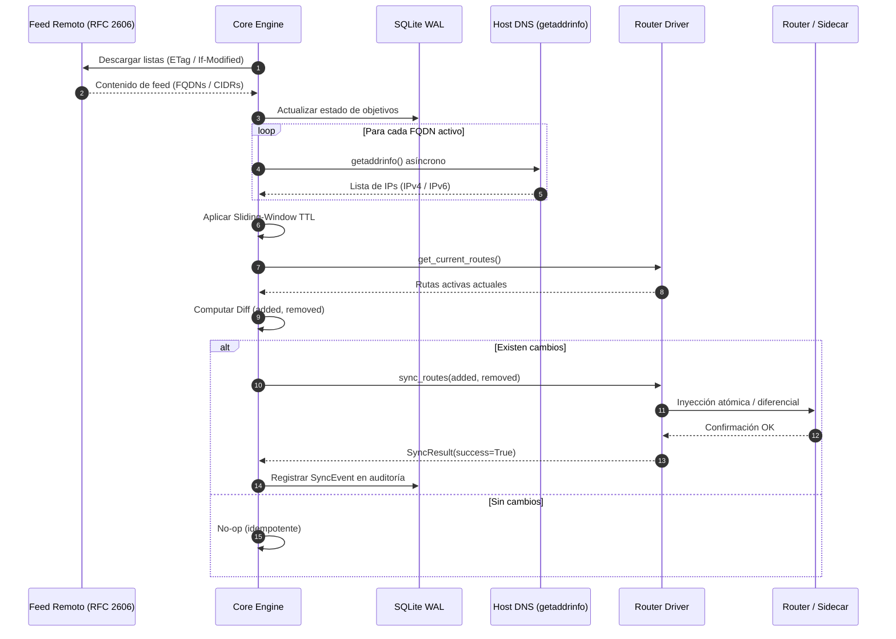
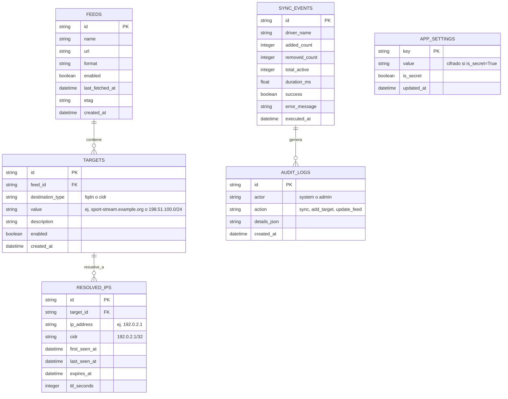

# TeByPass — Arquitectura del Sistema

Este documento describe la arquitectura modular y desacoplada de TeByPass, los contratos formales entre capas, el modelo de datos en SQLite WAL y el ciclo de vida de los paquetes en el plano de datos.

---

## 1. Visión General y Diagramas de Arquitectura

TeByPass sigue el principio estricto de **0 Monolitos**. El sistema está estructurado en capas aisladas con responsabilidades delimitadas y comunicación mediante contratos explícitos.

### 1.1 Diagrama de Componentes (Mermaid)

```mermaid
graph TB
    subgraph UI_API ["Capa de Presentación y API (app/api)"]
        WebUI["Web UI Dashboard\n(Jinja2 + Alpine.js)"]
        RestAPI["FastAPI Endpoints\n(/api/v1/routes, /api/v1/feeds, /api/v1/status)"]
    end

    subgraph CORE ["Capa Core Engine (app/core)"]
        Engine["Reconciliation Engine\n(app.core.engine)"]
        Resolver["Native DNS Resolver\n(app.core.resolver)"]
        Cache["Sliding Window Cache\n(app.core.cache)"]
        FeedManager["Feed Ingestion Service\n(app.core.feeds)"]
    end

    subgraph STORAGE ["Capa de Persistencia (app/db)"]
        SQLiteWAL["SQLite Database\n(PRAGMA journal_mode=WAL)"]
    end

    subgraph DRIVERS ["Capa de Abstracción de Red (app/drivers)"]
        BaseDriver["<<interface>>\nBaseRouterDriver"]
        MockDriver["MockRouterDriver\n(In-Memory/Tests)"]
        GatewayDriver["VirtualGatewayDriver\n(nftables/Unix Socket)"]
        UniFiDriver["UniFiRouterDriver\n(UniFi REST/SSH)"]
        MikroTikDriver["MikroTikRouterDriver\n(RouterOS REST API)"]
    end

    subgraph SIDECAR ["Plano de Datos Sidecar (gateway/)"]
        AlpineSidecar["Alpine Linux Sidecar\n(nftables + WireGuard wg0)"]
    end

    WebUI --> RestAPI
    RestAPI --> Engine
    RestAPI --> FeedManager
    FeedManager --> SQLiteWAL
    Engine --> Resolver
    Resolver --> Cache
    Engine --> SQLiteWAL
    Engine --> BaseDriver
    BaseDriver <|-- MockDriver
    BaseDriver <|-- GatewayDriver
    BaseDriver <|-- UniFiDriver
    BaseDriver <|-- MikroTikDriver
    GatewayDriver -.->|IPC / CLI| AlpineSidecar
```

### 1.2 Flujo de Datos y Reconciliación



---

## 2. Descomposición de Módulos

### 2.1 Core Engine (`app/core`)
- `config.py`: Definición tipada de la configuración bootstrap del sistema mediante `pydantic-settings.BaseSettings`. Lectura de variables base (`TEBYPASS_PORT`, `TEBYPASS_DATABASE_URL`).
- `settings_store.py`: Persistencia en SQLite de la configuración operativa editable desde la interfaz web (driver, credenciales, intervalos, fail-closed, etc.) con hot-reload en memoria.
- `crypto.py`: Cifrado y descifrado simétrico autenticado (Fernet / AES-128-CBC + HMAC-SHA256) para proteger secretos en reposo en la base de datos SQLite.
- `resolver.py`: Servicio asíncrono de resolución DNS. Utiliza `asyncio.get_running_loop().getaddrinfo` para apoyarse en la pila nativa del sistema operativo (`libc`).
- `cache.py`: Almacén en memoria de resoluciones con lógica de ventana deslizante. Extiende el TTL de rutas dinámicas si se detecta actividad continua.
- `feeds.py`: Clientes HTTP asíncronos (`httpx.AsyncClient`) para descarga e interpretación de feeds (StopLiga, HayAHora, texto plano).
- `feeds_sync.py`: Tareas de sincronización y refresco no destructivo de feeds remotos respetando cabeceras `ETag` e `If-Modified-Since`.
- `bootstrap.py`: Inicialización de semillas en SQLite (alta inicial del feed comunitario desactivado por defecto).
- `version.py`: Detección dinámica del commit de Git en Python puro desde `.git` montado en modo lectura, sin binarios externos.
- `engine.py`: Orquestador principal que ejecuta el bucle de sincronización, invoca la resolución, compara el estado deseado contra el estado del router y llama al driver.

### 2.2 Capa de Base de Datos (`app/db`)
- `session.py`: Fábrica de sesiones asíncronas con `aiosqlite` y SQLAlchemy 2.0. Aplica automáticamente `PRAGMA journal_mode=WAL;` y `PRAGMA synchronous=NORMAL;` en la inicialización.
- `models.py`: Modelos declarativos que definen las entidades de persistencia.

### 2.3 Capa de Drivers (`app/drivers`)
- `base.py`: Define el contrato formal `BaseRouterDriver` y las estructuras de datos (`TargetCIDR`, `SyncResult`, `DriverStatus`).
- `mock.py`: Implementación en memoria que simula la tabla de rutas para pruebas automatizadas y ejecución local sin hardware.
- `virtual_gateway.py`: Driver que interactúa directamente con el sidecar de red o con el `nftables` del host para actualizar sets dinámicos.
- `unifi.py`: Driver para controladores UniFi Dream Machine / Cloud Gateway mediante la API de firewall groups o rutas estáticas.
- `mikrotik.py`: Driver para MikroTik RouterOS v7 usando la API REST `/ip/firewall/address-list`.

---

## 3. Contratos Formales de Drivers (`BaseRouterDriver`)

Todos los drivers deben implementar rigurosamente la clase abstracta base:

```python
from abc import ABC, abstractmethod
from dataclasses import dataclass
from datetime import datetime
from enum import Enum


class DriverHealth(str, Enum):
    HEALTHY = "healthy"
    DEGRADED = "degraded"
    UNHEALTHY = "unhealthy"


@dataclass(frozen=True)
class TargetCIDR:
    cidr: str
    target_id: str
    description: str
    expires_at: datetime | None = None


@dataclass(frozen=True)
class SyncResult:
    driver_name: str
    added_count: int
    removed_count: int
    total_active: int
    duration_ms: float
    success: bool
    error_message: str | None = None


@dataclass(frozen=True)
class DriverStatus:
    driver_name: str
    health: DriverHealth
    active_routes_count: int
    last_sync: datetime | None
    details: dict[str, str | int | bool]


class BaseRouterDriver(ABC):
    """Contrato base abstracto para todos los drivers de enrutamiento."""

    @abstractmethod
    async def initialize(self) -> None:
        """Inicializa conexiones o recursos necesarios."""
        pass

    @abstractmethod
    async def get_current_routes(self) -> set[str]:
        """Obtiene el conjunto de CIDRs actualmente inyectados en el router."""
        pass

    @abstractmethod
    async def sync_routes(
        self,
        to_add: set[TargetCIDR],
        to_remove: set[str],
    ) -> SyncResult:
        """Aplica la diferencia de rutas de forma atómica e idempotente."""
        pass

    @abstractmethod
    async def health_check(self) -> DriverStatus:
        """Comprueba la conectividad y estado operativo del router o sidecar."""
        pass

    @abstractmethod
    async def close(self) -> None:
        """Libera sockets o sesiones activas."""
        pass
```

---

## 4. Modelo de Datos SQLite WAL

El almacenamiento utiliza SQLite con **Write-Ahead Logging (WAL)** para permitir lecturas concurrentes sin bloqueo durante las escrituras de reconciliación.

### 4.1 Entidades de la Base de Datos



---

## 5. Ciclo de Vida del Paquete (Plano de Datos L3)

En un despliegue con el Sidecar Gateway (`gateway/`), el flujo de paquetes es estrictamente en Capa 3:

```
[Cliente LAN (ej. Smart TV / PC)]
        │
        ▼ (Default Gateway = 192.0.2.254 - TeByPass Sidecar)
[TeByPass Gateway (Alpine Linux)]
        │
        ├─▶ nftables: ¿Destino coincide con @tebypass_targets?
        │
        ├──▶ [SÍ: Coincide]
        │         │
        │         ▼
        │    Tabla de Enrutamiento Policy (FIB mark 0x100)
        │         │
        │         ▼
        │    Interfaz WireGuard (wg0) ──▶ [Túnel VPN Salida]
        │
        └──▶ [NO: Tráfico Estándar]
                  │
                  ▼
             Enrutamiento Normal (eth0) ──▶ [Router Local / Internet Directo]
```

1. El dispositivo cliente en la LAN tiene configurada la IP del sidecar como su puerta de enlace o dispone de una ruta estática para los CIDRs catalogados.
2. El paquete IP ingresa en la interfaz `eth0` del sidecar.
3. El subsistema `nftables` evalúa el paquete en la cadena `PREROUTING`. Si la IP de destino pertenece al set `@tebypass_targets`, se marca el paquete con `meta mark set 0x100`.
4. El subsistema de routing de Linux (`ip rule`) dirige los paquetes con marca `0x100` a una tabla de rutas secundaria (`table 100`) cuyo gateway es la interfaz `wg0`.
5. Si no coincide con el set, el paquete sigue la tabla principal y sale directamente por la conexión física del router sin cifrado ni latencia añadida.

---

## 6. Modelo de Seguridad

1. **Cifrado en Reposo de Secretos (AES-128-CBC + HMAC-SHA256 Fernet)**:
   - Todas las credenciales sensibles (`unifi_api_key`, `unifi_password`, `mikrotik_password`) se cifran mediante criptografía simétrica autenticada antes de guardarse en SQLite.
   - La clave maestra reside en `/data/.secret_key` con permisos restringidos `0o600` en el volumen de datos (o derivada de `TEBYPASS_SECRET_KEY`).
   - Si la base de datos es respaldada o extraída, los secretos son ilegibles sin la clave maestra.
   - Migración transparente: cualquier secreto legado en texto plano se descifra y se re-encripta automáticamente en la primera lectura.
2. **Enmascarado Estricto de API y UI**:
   - Los endpoints `GET /settings` devuelven la máscara `***saved***` para todo secreto configurado. Ni la UI ni el tráfico HTTP exponen nunca las claves en claro ni los tokens cifrados.
   - Las mutaciones `PUT /settings` respetan la máscara: enviar `***saved***` no destruye el secreto existente.
3. **Control de Acceso y Sesión**:
   - Soporte para PIN Maestro opcional (`TEBYPASS_MASTER_PIN_HASH` con hash unidireccional y sal) para restringir cambios críticos.
   - Cookies de sesión firmadas con HMAC-SHA256 y expiración acotada.
4. **Protección de Archivos de Túnel (WireGuard)**:
   - El archivo de configuración de WireGuard `/data/wireguard/wg0.conf` se almacena con permisos `0o600`, impidiendo lecturas no privilegiadas en el host.
5. **Rate Limiting y Validación Estricta**:
   - Endpoints de autenticación y sincronización protegidos contra fuerza bruta.
   - Validación rigurosa de dominios y prefijos IP con `ipaddress` y Pydantic para prevenir inyecciones de comandos en drivers o shells de red.
